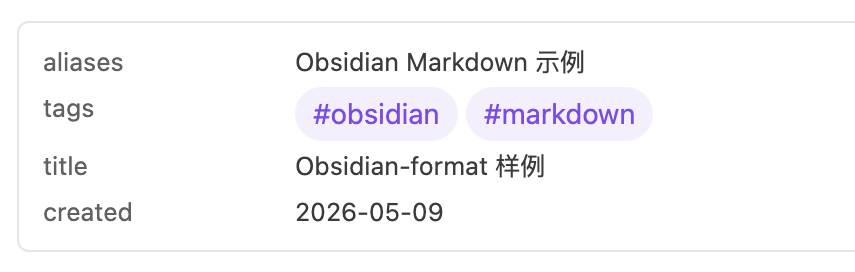
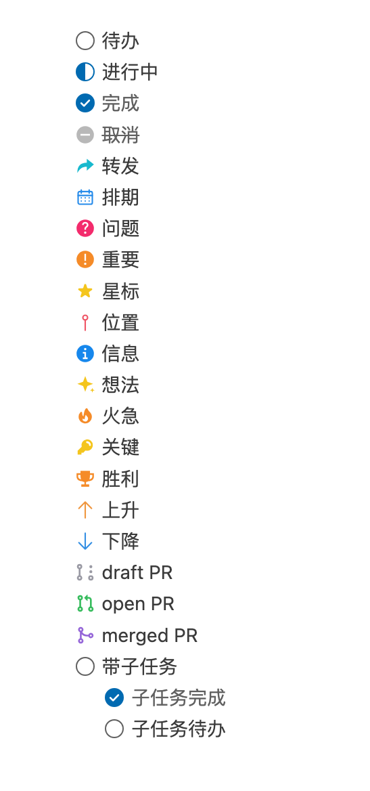
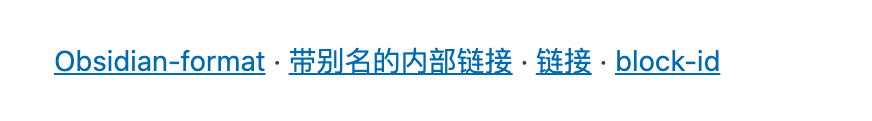
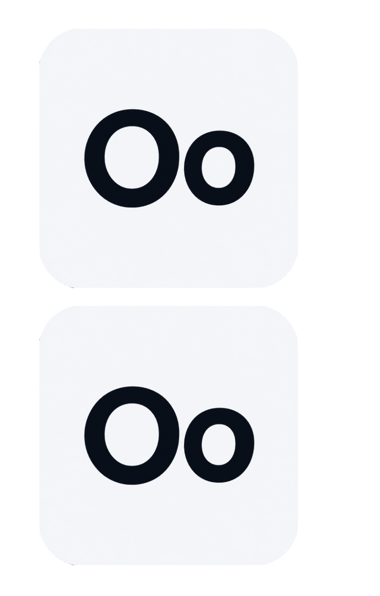
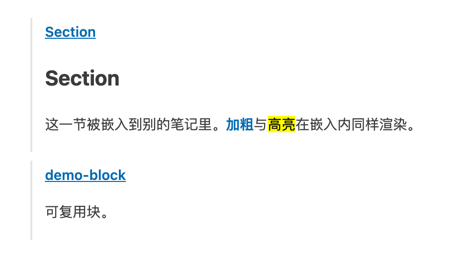
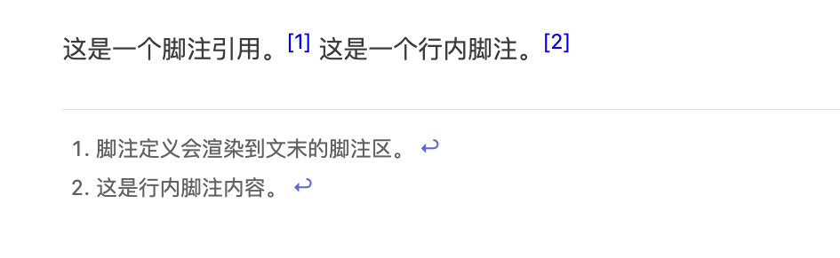
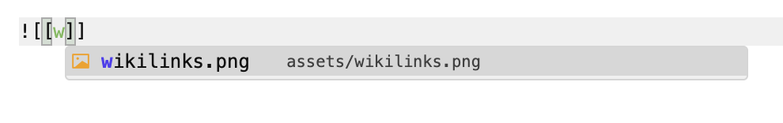
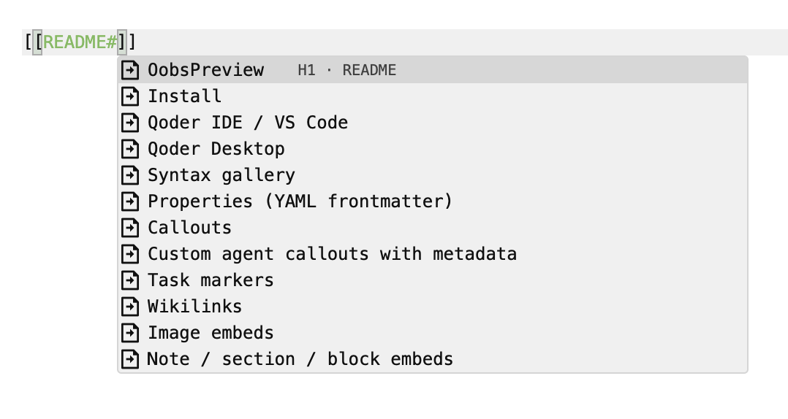
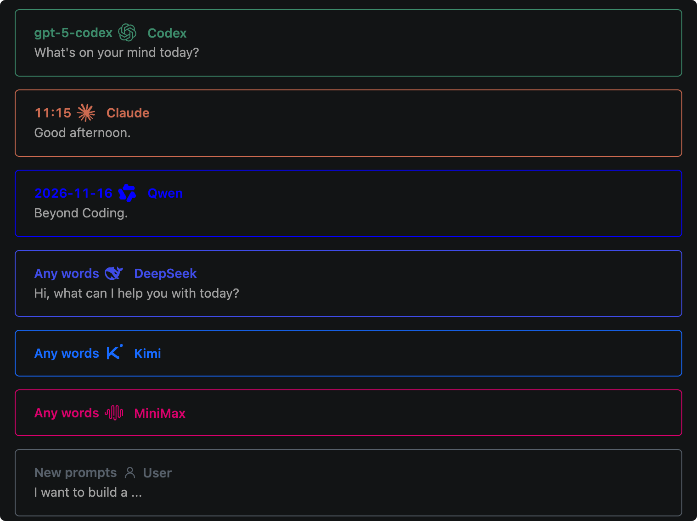

# OobsPreview

> A better Obsidian preview, inside the editor you already use.
> English · [中文](README.zh-CN.md)

OobsPreview lets the **built-in Markdown preview** of Qoder (IDE & Desktop) and VS Code render Obsidian-flavored Markdown directly.

## Install

### Qoder IDE / VS Code

Install from a `.vsix`:

```sh
cd /path/to/qoder-markdown-preview-enhanced  # the directory containing package.json
code --install-extension oobspreview-0.1.0.vsix
```

Then reload the window and open any Markdown preview. On Desktop, opening a `.md` file shows the Obsidian-enhanced preview directly, with only an **Edit** pill at the top right — click it to return to the native editor; click the file again to come back to the preview. Desktop currently runs in developer mode only, pending official listing.

## Supported syntax


### Properties (YAML frontmatter)

```markdown
---
title: Obsidian-format 样例
aliases:
  - Obsidian Markdown 示例
tags:
  - obsidian
  - markdown
created: 2026-05-09
---
```




### Callouts

```markdown
> [!note]
> 这是 note 提示块。

> [!tip]
> 这是 tip 提示块。

> [!warning]
> 这是 warning 提示块。

> [!info] 自定义标题
> Callout 可以自定义标题。

> [!todo]+ 默认展开
> 标题后加 `+` 表示默认展开。

> [!example]- 默认折叠
> 标题后加 `-` 表示默认折叠。
```


### Custom agent callouts (with metadata)

```markdown
> [!codex|gpt-5-codex]
> What's on your mind today? 

> [!claude|11:15]
> Good afternoon. 

> [!qwen|2026-11-16]
> Beyond Coding. 

> [!deepseek|Any words]
> Hi, what can I help you with today? 

> [!kimi|Any words]

> [!minimax|Any words]

> [!user|New prompts]
> I want to build a ...
```


`[!type|metadata]` puts the metadata on the title row and the body on a full-width row. Built-in agent types:
`codex`, `claude`, `deepseek`, `user`, `qwen`, `kimi`, `minimax`, etc., each with its own color and icon.

### Task markers

```markdown
- [ ] 待办
- [/] 进行中
- [x] 完成
- [-] 取消
- [>] 转发
- [<] 排期
- [?] 问题
- [!] 重要
- [*] 星标
- [l] 位置
- [i] 信息
- [I] 想法
- [f] 火急
- [k] 关键
- [w] 胜利
- [u] 上升
- [d] 下降
- [D] draft PR
- [P] open PR
- [M] merged PR
- [ ] 带子任务
  - [x] 子任务完成
  - [ ] 子任务待办
```



### Wikilinks

```markdown
[[Obsidian-format]] · [[Obsidian-format|带别名的内部链接]] · [[Obsidian-format#链接]] · [[Obsidian-format#^block-id]]
```



Resolved by file name across the vault; aliases, heading and block targets included. In tables, escape the alias pipe as `[[Note\|Alias]]`.


### Image embeds

```markdown
![[attachment.png|100]]

![[attachment.png|图片别名|100]]
```



### Note / heading / block embeds

```markdown
![[Demo Note#Section]]

![[Demo Note#^demo-block]]
```



Whole notes, single headings (`#Heading`) and single blocks (`#^block-id`) all embed inline;
markdown inside an embed renders with the same rules.

### Highlights

```markdown
==高亮文本==、 **加粗**、*斜体* ***加粗斜体***、`行内代码`
```


### Comments (hidden)

```markdown
可见文字%%这段注释不会显示%%继续可见。

%%
整段块注释也不会显示。
%%

注释前后的段落照常。
```


### Tags

```markdown
行内标签 #obsidian 与嵌套标签 #markdown/nested
```


### Footnotes

```markdown
这是一个脚注引用。[^note] 这是一个行内脚注。^[这是行内脚注内容。]

[^note]: 脚注定义会渲染到文末的脚注区。
```



### Block IDs

```markdown
这是一个可复用的块。 ^block-id

引用它：[[Demo#^block-id]]
```


### Editor completion (Qoder IDE / VS Code)

```markdown
[[]]          → notes in the vault (aliases and same-name paths included)
[[note#]]     → section headings inside that note
![[]]         → insert an image file name
```

For example:

```markdown
![[w]]
```





```markdown
[[README#]]
```



## Theming

Accent colors come from the host theme (`--vscode-textLink-foreground`, `--vscode-editor-background`, etc.);
light and dark themes are followed automatically. Semantic task / callout colors are fixed by design.



## Development

```sh
cd /path/to/qoder-markdown-preview-enhanced  # all commands below run from the project root
npm install
npm test        # offline unit + host-contract tests
npm run sample  # acceptance pass over Obsidian-format.md
npm run styles  # regenerate media/obsidian.css from styles/preview-theme.css
npm run desktop # assemble the Qoder Desktop plugin
npm run package # build the .vsix
node tools/make-screenshots.cjs  # regenerate assets/ and submission/screenshots/
```


## License & attribution

MIT — see `LICENSE`. Bundled and derived third-party work, icon geometry, and stylesheet provenance are listed in
`THIRD-PARTY-NOTICES.md`.