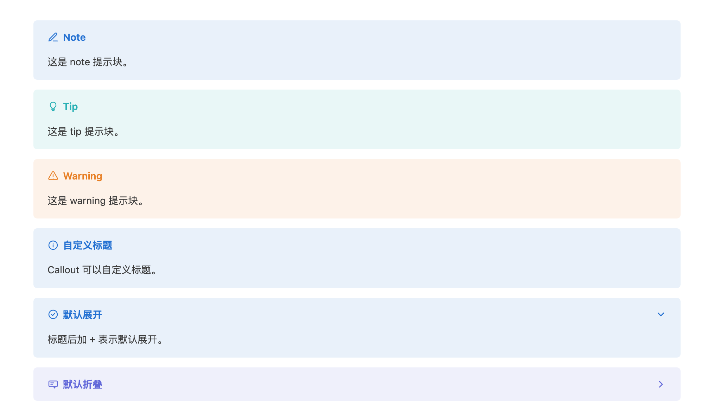

# OobsPreview

> 更好的 Obsidian 预览，就在你已经在用的编辑器里。
> [English](README.md) · 中文

渲染 Obsidian 风格 Markdown。

## 安装

### Qoder IDE / VS Code

用 `.vsix` 安装：

```sh
cd /path/to/qoder-markdown-preview-enhanced  # 含 package.json 的目录
code --install-extension oobspreview-0.1.0.vsix
```

然后重载窗口，打开任意 Markdown 预览。Desktop 端打开 `.md` 直接显示 Obsidian 增强预览，
右上角只有「编辑」药丸，点它回到官方原生编辑器；再点一次文件即可回到预览。
Desktop 目前只有开发者模式，等官方上架。

## 支持的语法


### Properties（YAML frontmatter）

```markdown
---
title: Obsidian-format 样例
aliases:
  - Obsidian Markdown 示例
tags:
  - obsidian
  - markdown
created: 2026-05-09
---
```

![[assets/properties.png|400]]


### Callout 提示块

```markdown
> [!note]
> 这是 note 提示块。

> [!tip]
> 这是 tip 提示块。

> [!warning]
> 这是 warning 提示块。

> [!info] 自定义标题
> Callout 可以自定义标题。

> [!todo]+ 默认展开
> 标题后加 `+` 表示默认展开。

> [!example]- 默认折叠
> 标题后加 `-` 表示默认折叠。
```




### 自定义 Agent Callout（带 metadata）

```markdown
> [!codex|gpt-5-codex]
> What's on your mind today? 

> [!claude|11:15]
> Good afternoon. 

> [!qwen|2026-11-16]
> Beyond Coding. 

> [!deepseek|Any words]
> Hi, what can I help you with today? 

> [!kimi|Any words]

> [!minimax|Any words]

> [!user|New prompts]
> I want to build a ...
```


![[Customized callouts.png|700]]

`[!type|metadata]` 把 metadata 放在标题行、正文占整行。内置 agent 类型：
`codex`、`claude`、`deepseek`、`user`、`qwen`、`kimi`、`minimax` 等，各有专属色与图标。

### 任务标记

```markdown
- [ ] 待办
- [/] 进行中
- [x] 完成
- [-] 取消
- [>] 转发
- [<] 排期
- [?] 问题
- [!] 重要
- [*] 星标
- [l] 位置
- [i] 信息
- [I] 想法
- [f] 火急
- [k] 关键
- [w] 胜利
- [u] 上升
- [d] 下降
- [D] draft PR
- [P] open PR
- [M] merged PR
- [ ] 带子任务
  - [x] 子任务完成
  - [ ] 子任务待办
```

![[tasks.png|300]]

### Wikilink 内部链接

```markdown
[[Obsidian-format]] · [[Obsidian-format|带别名的内部链接]] · [[Obsidian-format#链接]] · [[Obsidian-format#^block-id]]
```

![[wikilinks.png|400]]

按文件名在全库解析；含别名、标题、块目标。表格里别名竖线要转义为 `[[Note\|Alias]]`。


### 图片嵌入

```markdown
![[attachment.png|100]]

![[attachment.png|图片别名|100]]
```

![[assets/embed-image.png|100]]

### 笔记 / 标题 / 块嵌入

```markdown
![[Demo Note#Section]]

![[Demo Note#^demo-block]]
```

![[assets/embed-note.png|500]]

整篇笔记、单个标题（`#Heading`）、单个块（`#^block-id`）都能行内嵌入；
嵌入内部的 markdown 用同一套规则渲染。

### 高亮

```markdown
==高亮文本==、 **加粗**、*斜体* ***加粗斜体***、`行内代码`
```

![[assets/highlight.png|300]]

### 注释（隐藏）

```markdown
可见文字%%这段注释不会显示%%继续可见。

%%
整段块注释也不会显示。
%%

注释前后的段落照常。
```

![[comment.png|160]]

### 标签

```markdown
行内标签 #obsidian 与嵌套标签 #markdown/nested
```

![[assets/tags.png|350]]


### 脚注

```markdown
这是一个脚注引用。[^note] 这是一个行内脚注。^[这是行内脚注内容。]

[^note]: 脚注定义会渲染到文末的脚注区。
```
![[assets/footnotes.png|500]]


### 块 ID

```markdown
这是一个可复用的块。 ^block-id

引用它：[[Demo#^block-id]]
```
![[assets/block-id.png|280]]

### 编辑器补全（Qoder IDE / VS Code）

```markdown
[[]]          → 库内笔记（含别名与同名路径）
[[note#]]     → 该笔记内的章节标题
![[]]         → 插入图片文件名
```

例如：

```markdown
![[w]]
```


![[wikilinks-2.png|400]]


```markdown
[[README#]]
```

![[supp1.png|400]]

## 主题

强调色取自宿主主题（`--vscode-textLink-foreground`、`--vscode-editor-background` 等），
明暗主题自动跟随。任务 / callout 的语义色按设计固定。

![[dark.png|800]]

## 开发

```sh
cd /path/to/qoder-markdown-preview-enhanced  # 以下命令均在项目根运行
npm install
npm test        # 离线单元 + 宿主契约测试
npm run sample  # Obsidian-format.md 验收
npm run styles  # 由 styles/preview-theme.css 重生成 media/obsidian.css
npm run desktop # 组装 Qoder Desktop 插件
npm run package # 打 .vsix
node tools/make-screenshots.cjs  # 复现 assets/ 与 submission/screenshots/
```


## 许可与署名

MIT — 见 `LICENSE`。bundled 与衍生的第三方作品、图标几何、样式出处见
`THIRD-PARTY-NOTICES.md`。